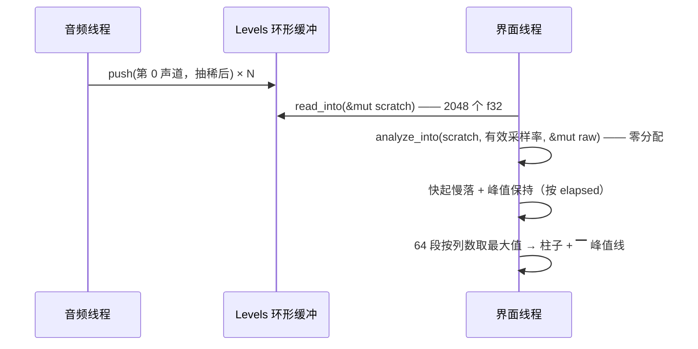

# canto 真频谱可视化设计（Y 全屏视图）

日期：2026-10-11
状态：待使用者复核
参考实现：[sijin-xb/kugou-tui](https://github.com/sijin-xb/kugou-tui) 的 `src/audio/{levels,spectrum}.rs` 与
`src/ui/views/visualizer.rs`（本地克隆一份逐行读过；下面凡标「照抄」的都是从那三个文件里取的结论）。

## 背景与目标

canto 的歌词是**行级**的，播放时屏幕上方那块内容区与底部歌词块之间没有别的东西。参考项目把
「真频谱」当卖点：对音频线程采到的**真实采样**做 FFT、对数分频成 64 段、画成柱子。

目标：把这件事搬进 canto，落点是 **`Y` 全屏视图**（现在叫「全屏歌词」），排布改成
**上半屏频谱 + 下半屏歌词**，`Y` 的语义随之变成「全屏正在播放」。

验收标准：

1. 播放中按 `Y`，上半屏是跟着音乐真实起伏的柱子（贝斯亮左边、人声中间、镲片右边），
   下半屏是照旧居中高亮的歌词。
2. 暂停 / 未播放时柱区不撒谎（显示提示、并回落到底），不残留上一帧的柱子。
3. `←` `→` 与进度条跳转照旧工作——**包装音频源不能把 seek 吞掉**。
4. Y 视图关着时不付这份算力：不做 FFT、不推进平滑、帧率也不提速。
5. 未引入任何新依赖。

## 非目标（YAGNI，明确不做）

- **逐字歌词（KRC / QQ `qrc=1` 加密 QRC）**：另一条独立链路（数据层要加解密），不在这一份里。
- 底部歌词块（`y`）里也画频谱：频谱只在 Y 视图出现，日常模式下不占任何空间、不付任何算力。
- 可配置的分割比例、主题/配色配置、省电开关（`lite_mode` 那种）。
- 柱状频谱之外的形态（波形、示波器、圆环、时域音量历史）——时域历史看着像频谱其实不是，
  参考实现的注释里专门记了这条弯路。
- 单独的「可视化」屏（数字键 `5`）：`1`–`4` 切屏的契约不动。

## 决策记录

| 决策 | 取值 | 理由 |
|---|---|---|
| 落点 | `Y` 全屏视图，内容区拆上下两块 | 不新增键位与屏，复用 `draw_lyric(area)`（它本来就吃任意 `Rect`） |
| 排布 | **频谱在上、歌词在下** | 频谱永远在动、歌词是要读的：动态元素放上方当氛围层，视线主焦点留在下半屏；与 `y` 底部歌词块的位置语言一致；频谱也不至于紧贴播放条（进度条与柱子都是横向动态条，挨在一起互相干扰） |
| 高度 | `歌词 = clamp(内容区/2, 7, 12)`，余量全给频谱 | 歌词的有用高度有上限（`MAX_LYRIC_HEIGHT = 12` 已是既有常量），频谱的高度收益是线性的 |
| 太矮不拆 | 内容区 < 14 行 → 只画歌词 | 15 行的下限终端拆出来是 3 行频谱，废的 |
| 无歌词 | 整块给频谱，标题 `频谱 · 歌名` | 守住现有「不画空框」原则；代价是歌词到达前布局会跳一次（一次性） |
| 未播放 | 那半居中提示，并清平滑/峰值 | 暂停时 rodio 不再吐采样，缓冲会冻在最后一帧，不主动清就是「看着在播却不出声」 |
| FFT | **自己写 radix-2，零依赖** | 只需要一个长度为 2 的幂的实序列正变换，不到 60 行；`Cargo.toml` 现在的取向就是「不为这点事引第三方库」 |
| 分析段数 | 固定 64 段，渲染时再按列数聚合 | 高频倾斜补偿是**按段**算的，段数一变标定就废；聚合取**最大值**（平均会把鼓点抹平） |
| 采样窗口 | 按**时间**（约 46ms）而非固定点数 | 抽稀 `max(1, rate/44100)` 倍，hi-res（192kHz）下低频分辨率不会从 21Hz/格退到 94Hz/格 |
| 柱内渐变 | **不做**（与参考实现有意不同） | canto 没有主题层（参考实现靠 `theme::mix` 拼渐变）；1–2 列宽的柱子在 7–18 行高度下渐变收益很低，两色够用 |
| 帧率 | 仅「Y 视图可见 **且** 正在播」时 150ms → 33ms | 6.7fps 下柱子是一格一跳；其余时候不付这份重绘 |
| 频谱数据 | **不进 `Snapshot`** | 它是 `Clone + PartialEq + Eq` 的低频快照；f32 且 30fps 更新的数据进去会污染它，也白拷一份 |
| 翻案留痕 | 新写本 spec，并在 `2026-10-11-tui-redesign-design.md` 的非目标那条加注记 | 旧决议里「频谱可视化等 voicefox 重型能力」被明确列为不做；翻案要留痕，历史不抹掉 |

## 1. 布局与尺寸契约

内容区 = 终端高度 − 5（播放条 4 行 + 状态行 1 行，都是常驻的）。

```text
┌ 频谱 ───────────────────────────────────────────────────────┐
│          ▁▂▄▆█▇▅▃▂▁      ▁▃▅▇█▆▄▂        ▁▂▃▄▅▆▇█▆▅▃▂        │
│      ▁▃▅▇█▆▄▂▁▁▂▃▄▅▆█▇▅▄▃▂▁  ▁▂▄▆█▅▃▂  ▁▂▃▅▆███▇▆▅▄▃▂▁    │
│  ▁▂▃▅▇█████▆▅▄▃▂▂▃▄▅▆▇█▇▆▅▄▃▂▁▁▂▃▄▅▆▇█▆▅▄▃▂▁▁▂▃▄▅▆▇▆▅▄▃▂  │
└─────────────────────────────────────────────────────────────┘
┌ 歌词 · 非酋 — 薛明媛、朱贺 ─────────────────────────────────┐
│                        昨夜同门云集                          │
│ ▶                      推杯又换盏                            │
│                        明月几时有                            │
└─────────────────────────────────────────────────────────────┘
┌ 播放 ───────────────────────────────────────────────────────┐
│ ♪ 非酋 — 薛明媛、朱贺 [FLAC 24.8MB] 播放中 · 顺序 · 3/42 · 音量 100%│
│ ██████████████░░░░░░░░░░░░░  01:32 / 02:52                  │
└─────────────────────────────────────────────────────────────┘
 Space 暂停 · ←/→ 跳转 · Y 退出全屏 · ? 帮助 │ 已插队《晴天》
```

| 终端高度 | 内容区 | 歌词块 | 频谱块 | 频谱可用高度 |
|---|---|---|---|---|
| 24 | 19 | 9 | 10 | 8 行 = 64 个 1/8 刻度 |
| 30 | 25 | 12 | 13 | 11 行 = 88 刻度 |
| 40 | 35 | 12 | 23 | 21 行 = 168 刻度 |
| 19 | 14 | 7 | 7 | 5 行 = 40 刻度 |
| 15（下限） | 10 | 不拆，只画歌词 | — | — |

规则：

- 两块各画**自己的边框与标题**（沿用现有约定：标题只报「这是什么」）。
- 歌词块标题**一字不改**：仍是 `lyric_title()` 的 `歌词 · 歌名`（`draw/lyric.rs` 与底部块共用，
  改动为零）。频谱块标题 `频谱`；无歌词时整块归它，标题变成 `频谱 · 歌名`。
- 频谱块内**只有柱子**：不画地面线、不画曲目信息——播放条就在正下方，同样的信息画两遍是噪音。
- 柱子底对齐，每根占 1–2 列（`stride = 可用宽 / 64`，`stride <= 1` 且宽度有余量时走 2 列换空隙），
  柱体最多 2 列（再宽就成方砖）、余量给空隙，整块居中（两侧留白对称，避免「图没画完」的错觉）。
- 全屏时底部不再单开歌词块（同一份歌词不画两遍，现有规矩不变）。

## 2. 模块与接口

| 单元 | 位置 | 职责 | 依赖 |
|---|---|---|---|
| FFT + 对数分频 | 新 `src/spectrum.rs` | 时域窗 → 64 段能量。**纯函数**，不碰设备、不碰 ratatui | 无 |
| 采样通道 | 新 `src/levels.rs` | 无锁环形缓冲 + 抽稀 + `LevelMeter<S>` 包装器 | `rodio::Source` |
| 挂载点 | `src/player.rs` | `Cmd::Play` 里 `open()` 成功后包一层再 `append`；新曲先 `clear()` | 上两个 |
| 句柄 | `src/player.rs` | `Engine::levels() -> Levels`（`Arc` 克隆），`start` / `silent` 各建一份交给音频线程 | — |
| 视图状态 | `src/tui/state.rs` | 三份 `Vec<f32>`（原始 / 平滑 / 峰值）+ `last_tick: Instant`，`tick()` 里推进 | `Engine::levels()` |
| 绘制 | 新 `src/tui/draw/spectrum.rs` | `draw_spectrum(frame, area, smooth, peak)` | ratatui |
| 布局 | `src/tui/draw/mod.rs` | `now_playing_full` 时把内容区切成两块 | 上两个 |

```rust
// src/spectrum.rs —— 纯计算，可单测
pub const WINDOW: usize = 2048;   // 抽稀后约 46ms
pub const BANDS: usize = 64;

/// 原地 radix-2 FFT。长度不等或不是 2 的幂 → 直接返回（显示用的旁路数据，不 panic）。
pub fn fft(re: &mut [f32], im: &mut [f32]);

/// 复用内部缓冲的分析器：逐帧零分配。
pub struct Analyzer { /* window / re / im / 幅度 */ }
impl Analyzer {
    pub fn new() -> Self;
    /// 采样窗口 → BANDS 个 0.0~1.0 写进 out。窗口不足 / 采样率未知 / out 为空 → out 清空。
    pub fn analyze_into(&mut self, samples: &[f32], sample_rate: u32, out: &mut Vec<f32>);
}

// src/levels.rs —— 音频线程与界面之间的单向通道
pub struct Levels { /* Arc<Vec<AtomicU32>> + cursor + 有效采样率 */ }
impl Levels {
    pub fn new() -> Self;
    fn push(&self, sample: f32);                   // 音频线程：每个（抽稀后的）采样一次
    pub fn read_into(&self, out: &mut Vec<f32>);   // 界面线程：每帧一次，最旧 → 最新
    pub fn clear(&self);
}

/// 包住音源：采样原样透传，顺带把第 0 声道记进 [`Levels`]。
pub struct LevelMeter<S> { inner: S, levels: Levels, /* 抽稀累加器 */ }
impl<S: Source> Iterator for LevelMeter<S> { type Item = f32; }
impl<S: Source> Source for LevelMeter<S> {
    // 逐项转发：current_span_len / channels / sample_rate / total_duration / try_seek
}
```

**`try_seek` 必须转发，这是硬要求**：`rodio::Source::try_seek` 的默认实现直接返回
`NotSupported`。漏了这一项，rodio 会认为整条音频不可跳转——`←`/`→` 与进度条跳转全部变成
debug 级别的静默失败，而播放本身完全正常，极难归因到这个包装层。现有 `Cmd::SeekBy` 正是走
`player.try_seek()`（见 `Cmd::SeekBy` 的锚点注释），所以这条要有单测钉死。

`Snapshot` 不动。`Engine` 只多一个 `levels: Levels` 字段与一个访问器；`open()` 的返回值不变
（仍然给裸 `Decoder<MediaSource>`），包装只发生在 `append` 那一处——缓存命中路径一行不改。

## 3. 算法与常量

| 常量 | 取值 | 依据 |
|---|---|---|
| `WINDOW` | 2048（抽稀后） | 约 46ms：跟得上鼓点，又有 ~21Hz 频率分辨率（44.1kHz 下） |
| `BANDS` | 64 固定 | 见决策记录；渲染层再按列数取最大值聚合 |
| `FREQ_MIN` / `FREQ_MAX` | 40Hz / `min(16kHz, 有效采样率/2)` | 低于 40Hz 是 DC 与次声（最左一根会常亮）；高于 16kHz 多为噪声，且多数有损编码已砍掉 |
| `DB_FLOOR` / `DB_CEIL` | −62 / −8 dB | 音乐的动态范围远宽于此，压到 54dB 窗口才看得出起伏 |
| `TILT_PER_BAND` | +0.25 dB/段 | 音乐能量天然集中在低频，不补偿右半边会永远趴着。**这是观感补偿，不是测量**（注释里要写明） |
| 抽稀因子 | `max(1, rate / 44100)` | 44.1k / 48k → 1；96k → 2；192k → 4。先对 `factor` 个采样取滑动平均再取一格（**不做低通直接抽稀会把 24–96kHz 的内容折叠进可闻段**，显示上就是高频段一片噪） |
| 平滑 | 起振 τ≈0.12s、回落 τ≈0.40s、峰值 60%/s、elapsed 夹到 0.5s | 按**真实时间**算，帧率从 150ms 变到 33ms 观感不变；不变量是时间常数 ≥ 3–4 倍帧间隔，否则块字符在 ▁ 与 █ 之间跳变（参考实现为此写过回归测试） |

算法（照抄参考实现，逐条都有理由）：

1. **Hann 窗**。直接截断一段采样会在两端产生频谱泄漏，能量糊到整个频域，表现出来是所有柱子一起微微发抖。
2. **归一化**。原始 DFT 幅度与点数成正比，不除以「窗函数之和 / 2」的话幅度动辄几百，换算成 dB 之后每段都顶格，画出来是一堵齐平的墙。
3. **对数分频**。FFT 出来的是线性频率：2048 点 44.1kHz 下每格约 21.5Hz，整个可闻低频段（20–200Hz）挤在最左两三格，右边一大半几乎不动。人耳对频率的感知是对数的，所以第 k 段覆盖 `[40 × ratio^k, 40 × ratio^(k+1))`。**不做这一步，画出来的不是频谱仪**。
4. **取窗口末尾的采样**：那是刚刚播过的声音，画出来才跟得上。
5. **单声道**：只取第 0 声道。立体声两个声道交错排列，全塞进一个窗口等于把两条不同波形混在一起，频谱是乱的。6 声道的 FLAC（`Q001` 档）同理。

## 4. 逐帧数据流、零分配与帧率



- **零分配**是有意的（参考实现每帧新开 4 个 2048 长的 `Vec`）：`Analyzer` 与 `Levels::read_into`
  都复用调用方的缓冲；`App` 持有 `scratch` / `raw` / `smooth` / `peak` 四份 `Vec<f32>`，容量在
  第一次之后不再变。
- **帧率**：`tui/mod.rs` 的 `TICK` 常量变成函数——`now_playing_full && phase == Playing` 时 33ms
  （约 30fps），否则维持 150ms。底部歌词块（`y`）不提速：行级歌词最多一行一跳。
- **关闭视图即停算**：Y 视图不可见时不调 `analyze_into`、不推进平滑；退出视图时清掉三份缓冲
  （否则下次进来会先闪一帧旧柱子）。
- 平滑在 `tick()` 里推进（`tick()` 就是每帧一次），elapsed 由 `App` 的 `last_tick: Instant` 算。
  事件循环是「draw → 等待 → 处理消息 → tick」，所以最多有一帧（33ms）的滞后，不可见。

## 5. 退化与错误处理

| 情形 | 行为 |
|---|---|
| `Playing` | 画柱子 |
| `Buffering` | 频谱块居中「缓冲中…」 |
| `Idle` / `Paused` / `Failed` | 频谱块居中「未在播放」，**并清平滑与峰值** |
| 无歌词（加载完成且确实没有） | 整块给频谱，标题 `频谱 · 歌名` |
| 歌词加载中 | 按「有歌词」处理，下半块居中「歌词加载中…」（与现有底部歌词块一致） |
| 内容区 < 14 行 | 不拆，只画歌词（就是今天的 `Y`） |
| 歌词显隐 | **规则不变**：全屏视图里的歌词不按播放态开关（现有行为——底部块才按 `player_active()` 开关），所以 Idle 时下半屏仍是上一首那一份歌词 |
| 切歌 | `Cmd::Play` 里 `append` 之前 `Levels::clear()`，否则上一首的尾巴先亮一下 |
| FFT 输入退化（窗口不足 / 采样率未知） | `analyze_into` 清空 `out`，调用方保持上一帧，**不 panic** |
| 音频线程已退出 | 沿用现有行为（`tick()` 里已有的那条报错），频谱跟着变成「未在播放」 |

## 6. 测试计划

能单测钉住的（都按 canto 现有的「纯函数 + `TestBackend`」套路）：

1. `spectrum.rs`：直流全落 bin 0；8 点 / 32Hz 下 4Hz 正弦落 bin 1 且旁瓣近零；长度不是 2 的幂
   不 panic 也不改输入。
2. **对数分频真的生效**：100Hz 正弦的峰值落在最左 1/4 段、8kHz 落在右半。线性分频必挂这两条。
3. 静音 → 全 0；窗口不足 / 采样率未知 → 空。
4. **`try_seek` 被转发**：用一个记录调用的假 `Source`（`Iterator` + `Source` 最小实现）包进
   `LevelMeter`，断言 `try_seek` / `channels` / `sample_rate` / `total_duration` /
   `current_span_len` 逐项转发到内层。
5. 抽稀：96kHz 输入抽稀 2 倍后，`Levels` 报的有效采样率是 48kHz，且滑动平均真的把
   相邻两采样平均了（拿一段锯齿波断言）。
6. 平滑：一帧鼓点不能一步走完；同一段 elapsed 拆成两帧推进与一帧推进结果一致（帧率无关）。
7. 绘制（`TestBackend`）：拆没拆、两块高度与标题、柱子数 = 频段数、满格 / 半格柱高、
   峰值线位置、未播放时是提示文案而不是残留柱子、`strip` 宽度不够时的降级。
8. `keys.rs`：`Y` 在 `Content` 与 `NowPlaying` 两个上下文里的映射不变（改名不改语义）。

**只能真跑验证的**：`Engine::silent` 的 mixer 没人拉样本，音频源根本不推进——测试里频谱恒为 0。
所以「柱子真的跟着音乐动」只能起一次真播放、用眼睛看。这一条写在这里，是不假装测试覆盖了它。

## 7. 改动清单

| 文件 | 改动 |
|---|---|
| `Cargo.toml` | **不动**（零新依赖） |
| 新 `src/spectrum.rs` | FFT + 分频 + `Analyzer` |
| 新 `src/levels.rs` | 环形缓冲 + 抽稀 + `LevelMeter<S>` |
| 新 `src/tui/draw/spectrum.rs` | 柱子绘制 |
| `src/main.rs` | 两行 `mod` |
| `src/player.rs` | `Levels` 字段与访问器、`append` 处包一层、`Cmd::Play` 前 `clear` |
| `src/tui/mod.rs` | `TICK` 常量 → 按状态取值的函数 |
| `src/tui/state.rs` | 四份缓冲 + `last_tick` + 平滑推进 + 布局/退化判定 |
| `src/tui/keys.rs` | `Action::ToggleLyricFull` → `ToggleNowPlaying`、`Context::LyricFull` → `NowPlaying`（含注释与单测） |
| `src/tui/draw/mod.rs` | 拆上下两块（含注释与单测） |
| `src/tui/draw/overlay.rs` | 帮助文案：「Y 全屏歌词」→「Y 全屏：歌词 + 频谱」 |
| `README.md` | 功能表加一行；键位表 `Y` 那行改写 |
| `docs/design.md` | 加一节：FFT 分频的取舍、抽稀、192kHz 的限制口径 |
| `docs/superpowers/specs/2026-10-11-tui-redesign-design.md` | 非目标那条加翻案注记 |

命名：`lyric_full` 字段 → `now_playing_full`（名字要报「这是什么」，这个视图不再只是歌词）。

## 8. 风险与已知限制

- **hi-res 的高频段显示质量**：抽稀用滑动平均做了粗低通，但 192kHz 的超声波内容在 16kHz
  以上的段位仍可能有轻微噪底。**只影响显示，音频一个采样都没动**（包装器是透传的）。
- **测试盲区**：见 §6 最后一段。频谱这条链路的端到端证据只有一次真播放。
- **33ms 的代价**：只在 Y 视图开着且在播时付出。终端一次重绘是整屏 diff，30fps 是重绘成本
  与观感的折中；如果真机上觉得费电，把 `TICK` 提到 50ms（20fps）是唯一要改的数字。
- **观感常数（τ、TILT、DB 窗口）需要真机微调**：这是本设计里唯一不能靠单测定的部分，
  其余都能钉住。
- 「停一会儿再切回 Y 视图」时环形缓冲里是旧波形——按 §5 的规则此时 `phase` 要么是 `Playing`
  （缓冲在持续刷新）要么已清空，不会画出一段不动的旧柱子。

## 与旧决议的关系

`2026-10-11-tui-redesign-design.md` 的「非目标（YAGNI，明确不做）」里第四条是
「频谱可视化等 voicefox 重型能力」。本 spec 是对那一条的**部分翻案**：只做真频谱，
不含逐字歌词、封面、均衡器等其它重型能力。旧文档保留原样并加一行注记指向本文件。
