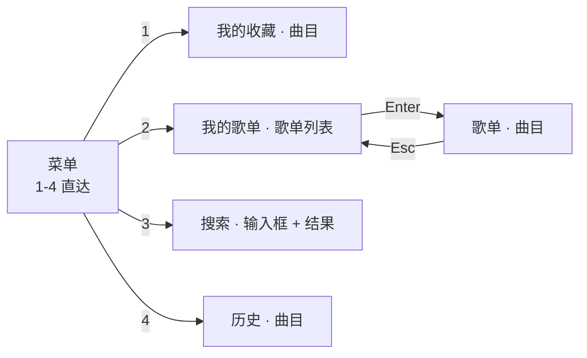
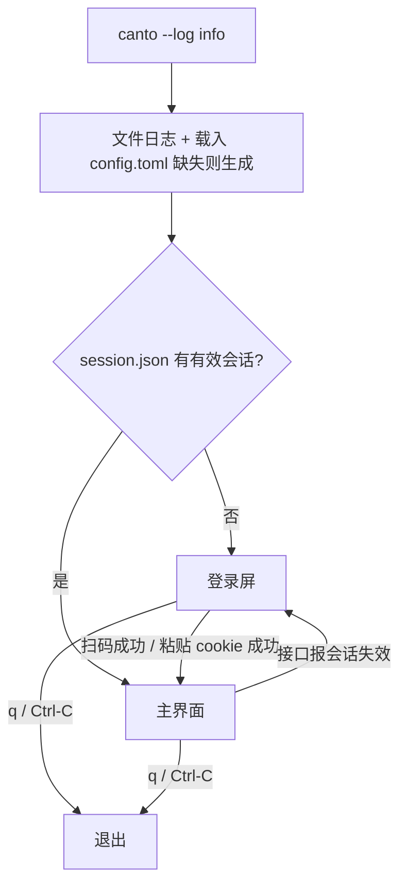

# canto 终端界面重构设计（导航 / 布局 / 队列 / 登录屏）

日期：2026-10-11
状态：已与使用者逐节确认，待复核

## 背景与目标

canto 是一个自用的 QQ 音乐 TUI 播放器，功能链路已通（扫码/粘贴 cookie 登录、歌单、播放、歌词、搜索、下载、歌单写入）。
当前界面的问题（使用者确认的痛点，按重要程度）：

1. **队列不可见、不可控**：队列只是「按下播放那一刻的曲目快照」，界面上看不到下一首是什么，不能增删跳。
2. **搜索顶掉浏览上下文**：搜索结果直接占据右栏，原来在看的歌单被覆盖（`App::shown` 被改写），要回去得重新进一次。
3. **布局一头浪费一头拥挤**：左栏固定 26 列大片留白；歌词挤在右下 1/3（约 5–8 行）；播放条恒占 4 行。
4. **登录只能在 CLI 完成**：`cargo run -- login` 是独立命令，二维码需要约 111×60 的终端，装不下时只落 PNG，得自己去打开图片。

目标：一次重构解决以上四点，并把「TUI 是唯一入口」定下来——未登录先出登录屏，登录后进主界面。

## 非目标（YAGNI，明确不做）

- 鼠标支持、可配置键位、主题/配色配置。
- 队列内容与各视图选中位置的持久化（退出即丢）。
- 多音源、封面图、均衡器、睡眠定时器。
- CLI 数据子命令的保留（全部删除，见下）。
- 频谱可视化等 voicefox 重型能力。

## 决策记录

| 决策 | 取值 | 理由 |
|---|---|---|
| 骨架 | 左侧导航菜单 + 右侧主区（上）+ 歌词（下）+ 全宽播放条 | 菜单管「我在哪」、主区管「这里有什么」，比「左栏既是目录又是列表」清晰；比「侧栏面板可切」少一层状态 |
| 队列形态 | 显式队列 + `u` 浮层 | 队列是独立数据（可增删插），浮层不与主区争空间 |
| 歌词位置 | 主区下方，播放中且有歌词才占位 | 宽屏下横排歌词居中可读；不播放时不画空框 |
| 搜索上下文 | 搜索结果占主区，菜单项与视图状态各自保留 | 切菜单不丢状态，不需要「返回栈」跨菜单 |
| 音质偏好 | `config.toml`，TUI 不提供设置界面 | 使用频率低，不值得一个设置页 |
| 登录屏 | 与主界面同一 ratatui 循环内的 `Screen::Login` | 二维码、粘贴输入、错误提示同屏；`qr.rs` 不再 `print!` |
| CLI | 只留 `--log`（+ `--help` / `--version`） | 使用场景全在 TUI；排查靠 `--log` 与日志文件 |
| 交付 | 一份设计文档 + 四阶段实施计划 | 四阶段共享同一份键位与布局契约 |

## 1. 骨架与尺寸契约

```
┌ 菜单 ─────┐┌ 我的歌单 › 嗯（42 首） ──────────────────────────┐
│ ♥ 我的收藏││ ▶ 04:36 FLAC 27.2MB 山水之间 — 许嵩            │
│ ≡ 我的歌单││   02:52 FLAC 24.8MB 非酋 — 薛明媛、朱贺        │
│ ⌕ 搜索    ││   03:10 320   9.1MB 乌梅子酱 — 李荣浩          │
│ ↺ 历史    ││                                                 │
└───────────┘└─────────────────────────────────────────────────┘
             ┌ 歌词 ───────────────────────────────────────────┐
             │                    昨夜同门云集                  │
             │ ▶                  推杯又换盏                   │
             └──────────────────────────────────────────────────┘
┌ 播放 ───────────────────────────────────────────────────────────┐
│ ♪ 非酋 — 薛明媛、朱贺  [FLAC 24.8MB] 播放中 · 顺序 · 3/42 · 100% │
│ ██████████████░░░░░░░░░░░░░  01:32 / 02:52                      │
└─────────────────────────────────────────────────────────────────┘
 Enter 播放 · a 追加队列 · A 插队 · u 队列 · y 歌词 · ? 帮助 │ 已插队《晴天》
```

| 区域 | 规则 |
|---|---|
| 菜单 | 固定 16 列。四项：`♥ 我的收藏` / `≡ 我的歌单` / `⌕ 搜索` / `↺ 历史`。高亮是**游标**：`j`/`k` 只挪它，`Enter` 才切屏（见第 2 节）。**不显示账号信息** |
| 主区 | 横向吃满剩余宽度；纵向上边界由歌词块高度决定 |
| 歌词块 | 仅在**播放中且有歌词**时占位，高度 `clamp(主区高度 / 3, 5, 12)`；`y` 手动收起/展开；无播放或无歌词时整块不绘制 |
| 播放条 | 恒 4 行（上下边框 + 信息行 + 进度条行），全宽。信息行含：曲名 — 歌手、`[档位 实际字节数]`、播放状态、播放模式、`序号/总数`、音量 |
| 状态行 | 播放条下独立 1 行。**左**为「当前焦点相关的 3–5 个键位提示」，**右**（右对齐）为一次性状态：加载 spinner、错误、结果提示。两者互不覆盖（现状是二者抢同一位置，加载中看不到键位）。浮层打开时左侧切换为该浮层的键位提示 |
| 加载中的主区 | 保留旧内容不清空，加载态只出现在状态行右侧，避免列表闪烁成空 |
| 未播放时 | 播放条信息行显示 `♪ —  已停止`，进度条 0%，`序号/总数` 与模式照常显示（队列可能非空） |
| 窄屏降级 | 宽度 < 100 列：菜单收成顶部一行页签（`1 我的收藏 · 2 我的歌单 · 3 搜索 · 4 历史`），主区吃满宽 |
| 矮屏降级 | 高度 < 20 行：歌词块自动关闭（不按比例挤） |
| 过小窗口 | 小于 60×15：只画一行「终端太小，请拉大到 ≥80×20」 |

## 2. 导航、焦点与键位



- ~~**焦点三站**~~：菜单栏与焦点概念在 §10.3 删除（只剩一块内容区；歌词块只自动跟随播放位置）。
- **移动 ≠ 切屏**：菜单游标高亮（`Nav::cursor`）与主区显示的那一屏（`Nav::menu`）是两份状态。焦点在菜单上时 `j`/`k`/`g`/`G` 只挪游标高亮，右侧内容一动不动；按 `Enter` 才切到游标那一项并把焦点放进主区。从主区 `Tab` 回菜单时，游标落在「正在看的那一屏」上，不会跳到别处。
- **`1`–`4` 语义**：数字键是「我知道要去哪」的显式意图——直接切到该项并进入（搜索项则聚焦输入框）。`Esc` 只关浮层/退层级，与菜单无关。
- **模态**：`u`（队列浮层）、`?`（帮助浮层）、`p`（歌单选择框）吞掉其它键，`Esc` 关闭。
- **`Esc` / `Backspace` 的生效条件**：仅在有上级（歌单曲目 → 歌单列表）、有输入态、或浮层打开时生效；一级视图（我的收藏 / 历史 / 搜索）在无输入、无浮层时不做事（**不**退出程序）。
- **搜索视图**：主区顶部恒一行输入框（进入该菜单项时自动聚焦），下方为结果列表。输入态下除 `Enter`（搜索）、`Esc`（退出输入态）、`Backspace`（删字符）外的可打印字符一律入缓冲；输入态吞掉 `j`/`k` 等导航键，退出输入态后列表才可导航。
- **帮助浮层**：按当前菜单项列出可用键（全局键 + 该视图键 + 该视图的浮层键），底部一行 `L 登出`；`Esc` 或 `?` 关闭。
- **「我的歌单」里没有「我喜欢」**：它是菜单第一项，不该在歌单列表里重复出现（`f` 负责写「我喜欢」）。因此在装载歌单时就按 `is_favorites` 过滤掉。
- **视图状态**：每个菜单项各存自己的列表与选中位置，切换菜单不丢。「我的歌单」的曲目层是深度 1 的压栈视图，`Esc` / `Backspace` 返回歌单列表；面包屑写在主区标题：`我的歌单 › 嗯（42 首）`。
- `/` = **筛选当前列表**（任何位置可用）；搜索屏的入口是菜单第 3 项（进去即可打字）。搜索结果留在主区，切走后切回仍在（解决痛点 2）。两者的区别与取舍见 §10。

### 键位表

| 键 | 作用 |
|---|---|
| `1`–`4` | **切屏**（`1` 收藏 · `2` 歌单 · `3` 搜索 · `4` 历史）。§10.3 起这是唯一的切屏入口 |
| ~~`Tab` / `Shift+Tab`~~ | ~~焦点循环~~ —— §10.3 删掉了焦点概念（只剩一块内容区） |
| `j` / `k`、`↓` / `↑` | 移动选择（焦点在菜单上时**只挪高亮，不切屏**） |
| `g` / `G`、`Home` / `End` | 首 / 尾 |
| `PgUp` / `PgDn`、`Ctrl+U` / `Ctrl+D` | 翻页 |
| `Enter` | 歌单列表 = 往下进一层；曲目列表 = 以此列表开新队列并从该首播放 |
| `Esc` / `Backspace` | 返回上级 / 取消输入 / 关浮层 |
| `Space` | 播放 / 暂停 |
| `n` / `b` | 下一首 / 上一首 |
| `←` / `→`、`h` / `l` | 后退 / 前进 10 秒 |
| `+` / `-`、`,` / `.` | 音量 ±5% |
| `m` | 播放模式：顺序 → 列表循环 → 单曲 → 随机 |
| `a` / `A` | 追加到队尾 / 插到下一首 |
| `p` | 把选中曲目加进某个歌单（原 `a` 的功能，键位搬家） |
| `x` | 从当前歌单移除选中曲目（「我喜欢」仍受服务端限制，见 README） |
| `f` | 收藏选中曲目 |
| `d` | 下载选中曲目（含同名歌词） |
| `u` | 队列浮层 |
| `y` | 歌词块开 / 关 |
| `/` | 筛选当前列表（输入即筛；`Enter` 确认、`Esc` 清空；生效后再按 `Esc` 也清） |
| `?` | 帮助浮层（按当前菜单项列出可用键；内含 `L` 登出） |
| `q` / `Ctrl-C` | 退出 |

**队列浮层内**：`j`/`k` 移动、`Enter` 跳播（不改队列顺序）、`d` 删除该项、`Shift+D` 清空队列、`Esc` 关闭；标题 `队列 3/42 · 来自《嗯》`。

**正在播标记**：改为按 `Song::mid` 与当前队列项比对（QQ 的 mid 全局唯一），替换现在 `song_label()` 的「标题 — 歌手」字符串比对。已知取舍：同一首歌在同一列表出现两次会同时标 `♪`。

## 3. 队列、播放模式、历史

### 队列模型

```rust
enum Mode { Sequential, LoopAll, RepeatOne, Shuffle }

struct Queue {
    items: Vec<Song>,        // Song 是 Clone，队列持克隆；来源列表之后怎么变都不影响队列
    index: usize,            // 当前项
    origin: String,          // 来源名：嗯 / 搜索：晴天 / 历史
    mode: Mode,
    shuffle: Vec<usize>,     // 随机模式本轮洗牌顺序
    shuffle_pos: usize,
}
```

边界语义（全部要与单测对齐）：

- `a` 追加到 `items` 末尾；`A` 插到 `index + 1`。
- 队列**空**时 `a` / `A` 等价于 Enter：以当前焦点列表开新队列并从选中首播放。
- `Enter` 在任一曲目列表 = **开新队列**（覆盖旧队列）并从该首播。
- 删除 `index` 之前的项：`index` 前移。删除当前项：播原 `index + 1`（在队尾则按模式决定）。队列删空：停播，状态行提示「队列已空」。
- 删除**不**影响各视图列表与歌单写入；队列是快照式拷贝。

### 播放模式（`m`）

| 模式 | 一首播完 | `n` | `b` |
|---|---|---|---|
| 顺序（默认） | 前进；到队尾**停**并提示「队列播完」 | 前进，到底则提示 | 后退，到头则提示 |
| 列表循环 | 到队尾回第 1 首 | 循环 | 循环 |
| 单曲 | 重播当前项 | 前进（显式意图） | 后退到顺序里的前一项 |
| 随机 | 沿本轮洗牌序前进；一轮播完重洗 | 洗牌序前进 | 洗牌序后退 |

「播完」的行为由队列决定，替换现在 `App::tick()` 里硬编码的 `queue_index + 1`。

**自动跳过不可播曲目**保持现有 `MAX_AUTO_SKIPS = 3` 语义，但「下一首」按当前模式取，成功播放清零。

### 历史

- **写入时机**：取流成功、引擎起播之后，写一条 `{ mid, title, singers, at, origin }`。
- **存储**：`~/.config/canto/history.json`，上限取自 `config.toml` 的 `history_limit`（默认 500），超出丢最旧。
- **去重**：同一 mid 与上一条相同则只更新时间戳（否则单曲循环会刷屏）。
- **视图**：`↺ 历史` 菜单项，倒序显示 `标题 — 歌手` ＋相对时间（`刚刚` / `12 分钟前` / `昨天 21:30`）＋来源。`Enter` = 以历史列表开新队列从那首播。`Shift+D` 清空整份历史。

## 4. 启动与登录



`App` 持有 `Screen::Login(LoginState) | Screen::Main(MainState)`；两屏共用同一个 ratatui 终端、同一个 `Msg` 通道模型，**不是**退出一个程序再进另一个。

```
┌ 登录 canto ───────────────────────────────────┐
│          █▀▀▀▀▀█ ▄▄ █▀▀▀▀▀█                  │
│          █ ▄▄▄ █ ██ █ ▄▄▄ █   ← 二维码居中     │
│          █▄▄▄▄▄█ ▀▀ █▄▄▄▄▄█                  │
│   手机 QQ 扫一扫 · 剩余 04:12                  │
│   [c] 粘贴 cookie    [o] 打开二维码图片        │
│   状态：等待扫码…                              │
└───────────────────────────────────────────────┘
```

- `qr.rs` 改成产出 `Vec<String>`（每字符格上下两像素），由 ratatui 居中渲染；不再 `print!`、不再依赖 `crossterm::terminal::size()` 做可用性判断（改由布局层判断并给出提示）。
- 终端小于 **112×60** 时不画残缺码，提示 `终端需要 ≥112×60（当前 100×30）`；`c` 可粘贴 cookie，`o` 用系统查看器打开 PNG（macOS `open`，Linux `xdg-open`）。
- `c`：单行 cookie 输入（整串可能数百字符，横向滚动），回车提交，失败就地报原因（沿用 `qq/cookie.rs` 的 `uin` + `qqmusic_key` 校验）。
- 扫码：沿用现有三跳链路（`qq/login.rs`），搬进 tokio 任务，结果走 `Msg`。
- **登出**：只在 `?` 帮助浮层内提供 `L`（清 session → 回登录屏），主界面不占键位，避免误按。
- **会话失效切屏**：见「待验证项」。

## 5. 配置与 CLI 收缩

`~/.config/canto/config.toml`（首次运行生成默认值）：

```toml
quality = "flac"                   # 从这一档往下找：hires | flac | 320 | 128
download_dir = "~/Music/canto"
history_limit = 500
```

- 新增依赖 `toml`。字段缺失用默认值；整个文件解析失败 → 用默认值启动并在状态行显示解析错误（不静默，也不因一个 typo 打不开）。
- `quality` 取值与现有 `--quality` 完全一致（`hires` / `flac` / `320` / `128`），作用于取流候选链起点（`qq::vkey::candidates(&song, Some(q))`）与下载。
- `download_dir` 取代现在硬编码的 `download::default_dir()`；值里的 `~` 在读取时展开为家目录（`dirs::home_dir()`）。

**CLI 收缩**：`cli.rs` 从 15 个变体（`tui` 加 14 个子命令：`login` `whoami` `playlists` `favorites` `tracks` `play` `favorite` `unfavorite` `add` `remove` `download` `search` `lyric` `logout`）缩到只剩 `--log`（`--help` / `--version` 保留）。`main.rs` 删除 `login()` / `print_playlists` / `print_tracks` / `print_song_rows` / `pick_song` / `parse_quality` / `load_tracks` 及各分支（约 300 行）。README 的「命令行子命令」整节删除，用法段改为登录屏说明与键位表。

## 6. 代码结构

```
src/
  main.rs      日志 → config → session → tui::run
  cli.rs       --log / --version
  paths.rs     文件路径：session.json / config.toml / history.json / canto.log / qr.png
  config.rs    config.toml 读写
  history.rs   历史：追加、上限截断、连续去重、清空
  qq/ media.rs download.rs player.rs model.rs http.rs session.rs   基本不动
  qr.rs        二维码 → Vec<String>
  tui/
    mod.rs     run / 事件循环 / Screen 切换
    state.rs   App 状态、消息处理、视图与焦点
    keys.rs    键位 → 动作（纯函数：KeyEvent + 上下文 → Action）
    queue.rs   队列模型与模式推进（纯逻辑，无 UI 依赖）
    login.rs   登录屏（二维码、cookie 输入、轮询、错误）
    draw/      mod（骨架与断点）/ menu / content / lyric / player / status / overlay
```

拆分理由：`keys.rs` 与 `queue.rs` 是最易错又最好测的部分（键位优先级、模式边界、队列增删边界），抽成纯逻辑以便单测，不埋在 `App` 里靠手点。

## 7. 测试策略

| 对象 | 测什么 |
|---|---|
| `queue.rs` | 四种模式的推进与边界（队尾停 / 循环 / 单曲重播 / 随机一轮不重复）、`a`/`A` 插入、删除（删当前项、删 index 之前、删空）、空队列时 `a` = 开新队列 |
| `history.rs` | 落盘与读回、超上限截断、连续同 mid 只更新时间戳、清空 |
| `config.rs` | 字段缺失用默认、坏 TOML 回退默认并带错误信息 |
| `keys.rs` | 模态优先（浮层/输入框吞键）、按焦点与菜单项映射 |
| 渲染 | 不做像素级断言；用 ratatui `TestBackend` 做少量冒烟断言（面包屑、状态行两段、队列浮层标题、帮助浮层存在），防「某块根本没画出来」 |
| 手工冒烟 | `cargo run` 全程：登录屏 → 四项菜单 → 搜索 → 插队/删队列/切模式 → 历史 → `?` |

现有测试需随改动更新：`qr.rs` 的 `show()` 签名变更（PNG 落盘与像素判定两条用例保留、断言改为对新接口）、`session.rs` 路径相关用例迁到 `paths.rs`。

## 8. 实施阶段

四阶段共享同一份键位与布局契约，每阶段结束都能 `cargo run` 验收。

1. **管道与收缩**：`config.toml`（`toml` 依赖、默认生成、坏文件回退）+ `history.rs` + `paths.rs` + CLI 收缩（`cli.rs` / `main.rs` 瘦身）+ README 相应段落。旧界面先跑在 config 上，可独立交付。
2. **新骨架**：`Screen` 机制、菜单与视图路由、焦点三站、三段布局与断点、状态行拆分、面包屑、翻页键、帮助浮层、改键（`a`→`p`、`1`–`4`、`?`）。队列相关键（`a`/`A`/`u`/`m`）本阶段**不绑定**，留到阶段 3 一并接入（不留空实现）。
3. **队列**：`queue.rs` 模型与模式、`a`/`A`/`u` 浮层、`m` 生效、自动跳过改造、历史菜单项与视图、`mid` 标记。
4. **登录屏**：`Screen::Login`、`qr.rs` widget 化、cookie 输入、扫码轮询搬进通道、会话失效切屏、帮助浮层内 `L` 登出。

## 9. 待验证项（实施期必须实测，不猜）

1. **会话失效的判定**：哪些响应码/文案算「未登录需重新登录」。现有代码只透出错误文本；阶段 4 先按 401 与明确的登录提示文案切屏，实测后收紧。
2. **二维码实际尺寸**：`qr.rs` 注释称 111×111（需 112×60）。实现 widget 版时用真实登录确认，尺寸契约随之调整。
3. ~~**历史重播的字段需求**~~ —— **已实测（2026-10-11）**：从历史记录按 mid 还原 `Song` 后重播成功（`曲终人散 — 张宇`，来源「我的收藏」；状态行走到 `取流` → `播放中`）。`qq::vkey::candidates` 用 `mid` 拼文件名、`media_mid` 缺失时回落到 `mid`，`qq::lyric::get` 用 `mid` + 可选 `song_id`，所以历史里只存 mid / 标题 / 歌手就够。代价：历史屏的行不显示时长与档位（还原出来的 `Song` 里是 0/空），也不做这些列的假显示。
4. **`quality` 与下载一致性**：`config.quality` 同时作用于播放取流与 `d` 下载；需确认搜索结果的档位元数据缺失（README 已知限制）不影响该链路。
5. **窄屏页签行的取舍**：<100 列时菜单变页签行，需在 80×24 实机确认主区仍可读、歌词块自动关闭生效。

## 10. 增量：列表内筛选与单例（实施后追加，2026-10-11）

### 10.1 `/` 改成「筛当前列表」

**问题**：`/` 原本跳到搜索屏，等于把「我就是想在这个列表里找一首」变成「换一屏、重搜一遍、原来的上下文丢掉」——痛点 2（浏览上下文）只解决了一半：结果留下了，但**当前列表**本身搜不了。

**决策**：`/` = 在当前显示的列表上按关键词过滤（输入即筛），搜索屏退出 `/` 的绑定、只从菜单第 3 项进。两者职责不重叠：搜索是「去网上找歌」，筛选是「在已经拿到的这批里找」。

语义：

| 行为 | 说明 |
|---|---|
| 匹配字段 | 曲目 = 标题 / 歌手；歌单列表 = 歌单名。都是小写包含匹配（大小写不敏感） |
| 输入 | 每个字符即时生效（列表跟着缩），不是回车才筛 |
| `Enter` | 收起输入框，**筛选留着**——接着 `Enter` 播的就是筛出来的子集（队列只装可见项） |
| `Esc`（输入框内） | 清空筛选并收起；生效后再按 `Esc`（`Back` 动作）也先清筛选，再按才退上一层视图 |
| 高亮 | 越筛越窄时留在原来那一条上；它被筛掉了才回第一行 |
| 标题 | 有筛选时挂徽标 `我的收藏 筛选「晴」12/489`（命中/总数） |
| 作用域 | 每屏各存自己的筛选词；换菜单、进出歌单都不互相干扰 |

**实现要点**（`tui/state.rs`）：`ListView<T>` 里 `items` 永远是**全量**数据，另存一份 `visible: Vec<usize>`（可见项在 `items` 里的下标），所有对外行为——`selected()`、`move_by`、`edge`、画哪几行、`visible_items()`——都走 `visible`。因此：

- 高亮的 `state.selected()` 是**可见行里的位置**，不是 `items` 下标；要原始下标用 `selected_index()`。
- 匹配规则是 `fn(&T, &str) -> bool` 函数指针，构造时给（`ListView::songs()` / `ListView::playlists()`），所以筛选逻辑不用为歌单再写一套泛型约束。
- `items` 与 `labels` 收成私有，只能经 `set_items` / `set_items_with_labels` 写，写的时候顺带清筛选并重算 `visible`——从类型上杜绝「数据换了、可见下标没换」这类错位。

### 10.2 单例运行

**问题**：会话文件（`session.json`）、历史、日志都是同一批文件，而写入都是「读-改-写」。两个实例同时跑，后写的覆盖先写的（最容易丢的是刚收藏的歌与刚听的历史）。

**决策**：启动时对 `~/.config/canto/canto.lock` 打 `flock(LOCK_EX | LOCK_NB)`（`src/instance.rs`）。拿不到就打印持有者 pid 并以退出码 1 结束。

- **锁跟进程走**：进程一死内核自动释放，所以不需要「僵尸锁」清理逻辑；锁文件留着不代表有人在跑，文件里只是持有者的 pid（报错时告诉你是哪个实例）。
- **位置**：在 `init_tracing` **之前**——`init_tracing` 会清空日志文件，被拒的第二个实例不该顺手抹掉第一个实例的日志。
- **验证**：真终端实测三连（A 起 → B 被拒且提示 pid → A 退出后 C 能起）＋ 单元测试「同一进程里第二次 acquire 必须失败、drop 之后必须能再拿到」。

### 10.3 去掉菜单栏，切屏只留数字键（2026-10-11）

**问题**：左侧菜单栏占 16 列，只干两件事——「我在哪」与「怎么切」。前者内容块标题
（`我的歌单 › 嗯（42 首）`）说得更清楚，后者数字键 `1`–`4` 就能做；窄屏时它还得变形
成顶部页签行，白白多一套断点与画法。

**决策**：删掉菜单栏与页签行，内容区吃满全宽；切屏只有数字键 `1`–`4`，完整键位表进
`?` 帮助浮层——那里是**唯一**一份键位表（状态行照旧只写当前屏可用键，不提切屏）。

**连带清掉的概念**（都只在「有菜单栏」时才成立）：

| 删掉 | 原因 |
|---|---|
| `Focus` 枚举、`Nav::focus`、`Nav::cursor`、`App::menu_state` | 只剩一块可聚焦区域；也没有「高亮了但还没进去」的游标中间态 |
| `Tab` / `Shift+Tab`（`FocusNext` / `FocusPrev`） | 没有第二站可切 |
| `keys::Context::Menu` | 与 `Content` 合并；`Esc` 不再需要「菜单是最外层」的特判 |
| `draw/menu.rs`（左列与页签行两种画法，约 55 行） | 整个删除 |
| `MENU_WIDTH` / `NARROW_WIDTH` / `Areas::menu` / `Areas::narrow` | 宽度不再是布局变量 |

**切屏语义**：数字键 = **回到这一屏上次的位置**。原 `switch_menu()` 只重置 `breadcrumb`、
不碰 `shown`，于是「在歌单曲目里按 `2`」会出现标题写着「我的歌单」而内容是曲目——切屏
入口收敛成一个之后必须定死：现在按 `shown` 一起还原面包屑，退层交给 `Esc`。

**已知取舍**：输入框（搜索 / 筛选）开着时数字键就是打字——这是文本框该有的行为，代价是
在搜索屏想切屏要先 `Esc`。

### 10.4 全屏歌词（`Y`）与当前句居中（2026-10-11）

**问题**：底部歌词块只有 5–12 行，长句 + 翻译一挤就只剩两三句可读；而且它的滚动交给
`List` 的「自动保可见」——只在选中行撞到边缘时才滚，当前句永远贴在下沿，眼睛得跟着它
往下追。

**决策**：
- `Y` = 全屏歌词：**只吃内容区**，播放条与状态行原地不动（`y` 仍是底部那一块的开关，
  两者独立）。全屏时底部不再单开一块——同一份歌词没有画两遍的道理。
- 两种画法共用一份渲染，滚动位置自己算（`lyric_rows` / `centered_scroll`）：把歌词摊平成
  「正文行 + 翻译行」，令当前句（含它的翻译，算一整块）落在可视区正中；到开头 / 结尾
  **夹住**，否则第一句之前、最后一句之后会飘出整屏空行。
- 删除 `App::lyric_state`：自己算滚动之后它没用了（原来的 `List` + 高亮选中项一并换成
  `Paragraph` + 按行染色）。
- 全屏时列表看不见，所以开一个新上下文 `Context::LyricFull`，只留「看得见」的键：
  `Space` / `n` / `b` / `←`→` / `+`-` / `m` / `u` / `1`–`4` / `?` / `q` / `Y` / `Esc`；
  `Enter` 与 `f` / `d` / `p` / `x` / `a` / `A` / `/` / `j` / `k` **不绑定**（防的是对着
  看不见的列表误操作）。
- `Esc` 的层级里插一层：帮助 → 队列浮层 → 选择框 → 输入框 → **全屏歌词** → 筛选 →
  退一层视图；数字键切屏也顺手退出全屏（切屏就是离开这一屏）。

**验证**：居中的数学用**假时间**直接单测（第 20 句落在 10 行窗口的正中、带翻译按两行算、
首尾夹住、窗口比内容高时不滚、前奏不亮任何行）；高亮染色用 `TestBackend` 断言当前句那
一行是黄 + 粗、别的行不是；真终端用 pyte 还原屏幕确认「全屏只占内容区、播放条与状态行
在位、中段时窗口确实滚起来了、`f` 在全屏里不响应」。

### 10.5 数据目录改到 `~/.config/canto`（2026-10-11）

**问题**：原来用 `dirs::config_dir()`，macOS 上落在 `~/Library/Application Support/canto`
——路径又长又不好找，和一堆别的 App 挤在同一个目录里。

**决策**：`paths::data_dir()` 改成 `~/.config/canto`（`dirs::home_dir()` + `.config`），
三平台同一套路径，备份 / 同步 / 手动翻文件都省事。`config_dir()` 只留给搬迁逻辑用。

**一次性搬迁**（`paths::migrate_legacy()`，启动时在 `init_tracing` **之前**调用）：
新目录不存在 + 老目录存在 → 整目录 `rename`（会话、配置、历史、日志、锁一起过去，
登录态不用重扫）；搬过之后不再动手。顺序很重要——`init_tracing` 会清空日志文件，
先初始化就等于把老日志留成孤儿。搬不动（权限 / 跨卷）不拦启动，只在 stderr 说明，
新目录会重新生成配置。

**验证**：真机把目录倒回老位置跑一次，确认「提示出现在 stderr + 新目录六个文件齐 +
老目录消失 + 借新目录启动仍是登录态（收藏 489 首自动加载）+ 历史还在 + 不再重复提示」；
单测覆盖「目录确实在 `~/.config` 下」「老目录整目录搬走 / 新目录已存在时不合并 / 老目录
不在时不动手」。

### 10.6 播放缓存、歌词目录分开、配置说清楚（2026-10-11）

**背景**：播放一直是纯流式（`media.rs`：一次 GET 顺序读，seek 才重开 `Range`），好处是
秒起播、不落盘，代价是重听 / 拖回都要重新从 CDN 取；另外 `config.toml` 里档位只有一行
`hires | flac | 320 | 128` 的注释，体积量级和默认值都得回来翻代码；下载把 `.lrc` 和音频
堆在同一个目录里，看着乱。

**决策**：

1. **播放缓存**：`~/.cache/canto`（跟数据目录分开——缓存可丢、可能几个 G，数据目录要小而
   可备份）。键 = `mid + 扩展名`（mid 全局唯一且不随 vkey 过期；换档位就是另一个文件）。
   - 读：命中完整缓存 → 直接读本地文件（0 网络、任意 seek）
   - 写：边播边顺序追加 `.part`；**只有从头顺序读完**（`prefix` 连成一片且铺到文件尾）才
     改名成正式缓存。跳着读出的洞一律不写，`Drop` 时删掉半截文件，启动时再清一遍遗留
     `.part`——所以缓存里**只有完整可用的文件**
   - 清理：启动时按 mtime「最久没听的先删」压到 `cache_mb`（默认 1024）以内；0 = 关掉
   - 下载功能不走缓存（它有自己的目录）
2. **档位规范名 + 说清楚**：`Quality::token()` 给每个档位一个正牌写法（`128` / `320` /
   `flac` / `hires`），`parse()` 继续收宽松写法；生成的 `config.toml` 逐行写出四档的
   体积量级。**默认档位改成 320**（自用播放器不需要无损）。
3. **歌词单独目录**：`lyrics_dir`（默认 `<音乐目录>/canto-lyrics`），下载时音频进
   `download_dir`、`.lrc` / `.trans.lrc` 进 `lyrics_dir`，同名便于配对。

**已知取舍**：缓存只能覆盖「听过一遍的歌」，所以它不是离线模式；第一次听仍然完全靠网络。
