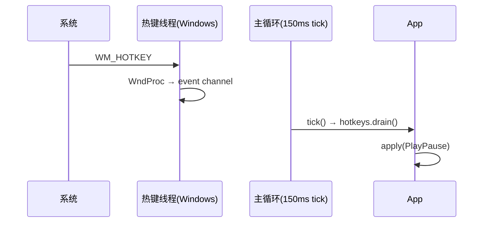

# canto 全局快捷键设计（TUI 在后台也能控制播放）

日期：2026-10-12
状态：待使用者复核

## 背景与目标

canto 通常停在一个 pane 里（或干脆被别的窗口盖住）。想切歌或调音量就得先切回终端——
本 spec 要的是**系统级全局快捷键**：canto 没在前台聚焦时，那几个组合照样生效。

要支持的动作与默认组合（都可配）：

| 动作 | 默认组合 |
|---|---|
| 播放 / 暂停 | `ctrl+shift+space` |
| 上一首 / 下一首 | `ctrl+shift+left` / `ctrl+shift+right` |
| 音量加 / 减 | `ctrl+shift+up` / `ctrl+shift+down` |

**固有代价（必须写进文档）**：系统级注册期间，那几个组合被 canto **独占**——其它程序收不到。
OS 无法做到「只在后台生效」，所以不做这种开关。

## 非目标（YAGNI，明确不做）

- **Linux / Wayland**：不做。crate 只支持 X11，Wayland 没有通用方案；这台机器也不是 Linux
  桌面。其它平台走空实现 + 启动时一句通知。
- **媒体键**（`MediaPlayPause` 之类）：crate 在 macOS 上要用 `CGEventTap`，会触发辅助功能
  授权弹窗；不做。默认组合用普通修饰键 + 普通键，不需要任何系统授权。
- **按住连发**：一次按下 = 一次动作（Windows 侧用 `MOD_NOREPEAT`）。要连发以后再说。
- **任意动作可绑**：只暴露上表五个动作，不允许使用者把热键绑到 `x`、`p` 之类界面键上。
- 不改现有应用内键位表。

## 决策记录

| 决策 | 取值 | 理由 |
|---|---|---|
| 实现 | `global-hotkey 0.8`（tauri 系） | 现成的 Windows/macOS 实现 + 字符串解析；Apache-2.0 OR MIT |
| 平台 | Windows + macOS | 使用者实际在用的两台；Linux 桌面明确不做 |
| 派发 | 复用 `keys::Action` → `App::apply()` | 与应用内按键同一条路径，不另立语义 |
| 生效范围 | 只在 `Screen::Main` | 登录屏没有可控制的东西 |
| 配置 | `[hotkeys]` 段，空串 = 禁用，**必须带修饰键** | 裸键会被系统级抢走（`space` 那种） |
| 失败处理 | 逐条失败 → 通知一行 + 日志，其余照常注册 | 不让一个坏组合废掉整组 |
| 线程模型 | Windows 专用线程跑消息循环；macOS 主线程 + 每帧泵 run loop | crate 的硬要求（见 §5，读源码确认） |

## 1. 依赖与版本影响

- 新增 `global-hotkey = "0.8"`（Apache-2.0 OR MIT）。它带进 `crossbeam-channel`、
  `keyboard-types`、`once_cell`、`thiserror`（都很小）。
- **Windows**：它用 `windows-sys 0.59`，我们现有 `0.61.2` → 树里会出现**两个版本**。功能无碍，
  代价是多编译一份绑定（windows-sys 是生成的 FFI 声明）。
- **macOS**：crate 自带 `objc2` + `objc2-app-kit`（只为媒体键那条路径链进来，我们不用媒体键）；
  我们自己还要加一个 `core-foundation` 用来泵 run loop（§5）。
- **Linux**：crate 的 `x11rb`/`xkeysym` 是 target-gated，不会编进我们的产物。

## 2. 模块与接口

| 单元 | 位置 | 职责 | 依赖 |
|---|---|---|---|
| `hotkeys` | `src/hotkeys.rs` | 平台无关接口；`cfg` 分派到三个实现 | `keys::Action`、`global_hotkey` |
| `hotkeys::windows` | 同文件 | 专用线程：隐藏窗口 + `RegisterHotKey` + 消息循环 | `global_hotkey` |
| `hotkeys::macos` | 同文件 | 主线程建 manager；`pump()` 泵 run loop | `global_hotkey`、`core-foundation` |
| `hotkeys::unsupported` | 同文件 | 空实现 + 一句说明 | — |

**只有 `hotkeys` 碰 crate 的类型**：它导出 `validate(keys: &str) -> Result<(), String>` 给
`config.rs` 做启动校验（所以 `Config` 里存的是字符串，不出现 `HotKey` 这种平台类型），
`install` 注册时再解析一次——5 个短串，成本可忽略，换来配置层干净。

```rust
/// 一条要注册的绑定：动作 + 配置里写的组合。
pub struct Binding { pub action: Action, pub keys: String }

/// 注册。返回的 `Hotkeys` 要一直拿着（Drop 即反注册）；第二条是逐条失败原因。
pub fn install(bindings: &[Binding]) -> (Hotkeys, Vec<String>);

impl Hotkeys {
    /// 取走这一轮攒下的事件（每个 tick 调一次）。
    pub fn drain(&self) -> Vec<Action>;
    /// macOS：泵一次主线程 run loop；其它平台是空操作。
    pub fn pump(&self);
}
```

- `install` 在 **`tui::run` 里**调用，**不在 `App::new` 里**：测试用的 `test_app()` 不该真去
  注册系统热键。
- 拿到的 `Hotkeys` 存进 `App.hotkeys`；`App::new` 里初始化成 `Hotkeys::none()`（空表、不注册、
  `drain()` 返回空，`pump()` 空操作），所以测试与「不支持平台」走的是同一条空路径。
- `App::tick()` 里 `hotkeys.drain()` → 逐个 `apply(action)`；`tui::run` 的循环开头 `pump()`
  （Windows/其它平台空操作）。
- 失败文案是纯函数，便于钉住：`failure_notice(&[String]) -> String`——一条时
  `全局热键注册失败：<组合>`，多条时 `全局热键注册失败 N 个（见日志）`（都在 32 列内）。

## 3. 配置契约

```toml
# 全局快捷键：canto 在后台（未聚焦）时也能用这几个键。
# 注意：注册期间**别的程序收不到这些组合**（系统级注册的固有代价）。
# 写法：修饰键在前、最后一个是要按的键；可用 ctrl / alt / shift / win，
# 键名如 space / up / down / left / f5 / a。空字符串 = 这个动作不注册。
[hotkeys]
play_pause  = "ctrl+shift+space"
next        = "ctrl+shift+right"
prev        = "ctrl+shift+left"
volume_up   = "ctrl+shift+up"
volume_down = "ctrl+shift+down"
```

| 情形 | 行为 |
|---|---|
| 没有 `[hotkeys]` 段 / 缺字段 | 用上表默认值 |
| 空串 `""` | 明确禁用该动作（不注册、不警告） |
| 组合解析不了（键名不认） | 该条不注册 + 一次性警告（`hotkeys::validate` 在配置阶段就报） |
| 没有修饰键（裸键，如 `"space"`） | 拒绝 + 一次性警告（会系统级抢键） |
| 两个动作写了同一组合 | 后者注册失败（Windows 报 `ERROR_HOTKEY_ALREADY_REGISTERED`）→ 通知 + 日志 |
| 解析实现 | crate 的 `FromStr`（别名：`ctrl`/`control`、`alt`/`option`、`win`/`super`/`cmd`、`up`/`arrowup`…），统一经 `hotkeys::validate` |

警告走 `config.rs` 已有的「一次性警告」机制（状态行通知槽一行 + 细节进日志）。配置模板
（`write_default`）要写上这段并带注释；README 的「功能」表、「配置」段、「已知限制」同步。

## 4. 动作与派发语义

| 热键 | Action | 现有行为（`App::apply`） |
|---|---|---|
| 播放 / 暂停 | `PlayPause` | `engine.toggle_pause()` |
| 上一首 / 下一首 | `Prev` / `Next` | `play_relative(false/true)`（按当前播放模式走） |
| 音量 ± | `VolumeDown` / `VolumeUp` | `adjust_volume(-5)` / `adjust_volume(+5)`（跟界面键同一个步长） |

- **只在 `Screen::Main` 派发**；登录屏忽略。
- 只消费 `Pressed`，忽略 `Released`（Windows 侧 crate 带 `MOD_NOREPEAT`，不会连发）。
- 默认组合与应用内键位不冲突（界面里没绑 `ctrl+shift+*`）。

## 5. 线程模型（读 crate 源码确认，这是本设计最要紧的一节）

| 平台 | crate 的实际行为 | 我们要做的 |
|---|---|---|
| Windows | `GlobalHotKeyManager::new()` 只在**调用线程**上建一个隐藏窗口；`RegisterHotKey` 之后 `WM_HOTKEY` 投递给**那个线程的消息队列**。crate **自己不起线程**。 | 专用线程：建 manager + `register_all` → 自己跑 `GetMessage`/`DispatchMessage` 循环。它不碰主线程、不碰 crossterm。`Drop` 时发停止信号 → 反注册 + `DestroyWindow` + 线程退出。 |
| macOS | `InstallEventHandler(GetApplicationEventTarget(), …)` + Carbon `RegisterEventHotKey`；文档明确要求**主线程**创建，事件由主 run loop 派发。 | manager 在**主线程**建（`tui::run` 就在主线程）；主循环每轮开头泵一次 `CFRunLoopRunInMode(kCFRunLoopDefaultMode, 0.0, true)`（非阻塞）。热键响应延迟 ≤ 现有 tick（150ms）。 |
| 其它 | 不支持（crate 仅 X11） | 空实现 + 启动时一句通知。 |



## 6. 退化与错误处理

| 情形 | 行为 |
|---|---|
| 某个组合被别的程序占了 | 该条注册失败 → 通知一行 + 日志；其余键照常注册 |
| 平台不支持 | 不注册 → 启动通知一句 + 日志，程序功能不受影响 |
| 五个全配成空串 | 不注册、不通知（使用者自己关的） |
| 退出 | Windows：`Drop` 反注册 + 销毁窗口 + 线程退出；macOS：`Drop` 走 crate 的反注册 |
| 两个实例 | 已有单例文件锁，第二个实例直接退出，不会出现两个进程抢同一组合 |

启动时的两条消息来源不同、都会落到那一个通知槽（后写的占位，完整内容都在日志）：

1. **配置阶段**（`config::load` 的一次性警告）：组合写错、裸键被拒。
2. **注册阶段**（`install` 返回的 `failures`）：组合被别的程序占用。

所以 `tui::run` 里的顺序是「先报配置警告，再报注册失败」——两条都发生时，状态行留下的是后者，
前者在 `canto.log` 里。

## 7. 测试计划

**单测**（能钉住的都钉住，沿用现有「纯函数 + 断言」套路）：

- `config.rs`：默认五条；别名（`control`/`win`/`arrowup`）等价；空串 = 禁用；裸键被拒 + 警告；
  垃圾键名被拒 + 警告；`[hotkeys]` 坏掉不影响别的字段。
- `hotkeys.rs`：`id → Action` 映射（同 id 两条时保留先注册的那条）；`failure_notice` 的两种形态
  与 32 列宽度；不支持平台时 `install` 返回空 + 说明文字。

**真机（Windows，我做）**——OS 级注册模拟不了，只能真按：

1. 启动 → 日志 `已注册 N 个全局热键`，状态行没有失败通知。
2. 焦点切到**别的窗口**（另一个 pane / 编辑器），按 `ctrl+shift+space` → 播放/暂停（播放条 + 日志）。
3. `ctrl+shift+up` / `down` → 播放条 `音量 N%` 变化 ±5。
4. `ctrl+shift+left` / `right` → 播放条曲名切换。
5. 冲突：把 `next` 临时改成与 `prev` 相同的组合 → 启动后状态行 `全局热键注册失败：…` + 日志，
   其余 4 条仍可用。
6. 退出 canto 后组合归还（用一个临时小程序 `RegisterHotKey` 同一组合验证；可选项）。

**真机（macOS，由使用者验；本机是 Windows，我做不了）**：同一份 1–4 的清单，
外加确认**不弹辅助功能授权**（我们不用媒体键）。验收结果回填到本 spec 或后续 plan。

## 8. 改动清单

| 文件 | 改动 |
|---|---|
| `Cargo.toml` | 加 `global-hotkey = "0.8"`；macOS 目标加 `core-foundation` |
| `src/hotkeys.rs` | 新增：接口 + 三个平台实现 + 单测 |
| `src/config.rs` | `[hotkeys]` 解析 / 校验 / 默认值 / 模板 + 测试 |
| `src/tui/state.rs` | `App.hotkeys` 字段；`tick()` 里 drain + 派发 |
| `src/tui/mod.rs` | `tui::run` 里 `install` + 失败通知；主循环开头 `pump()` |
| `README.md` | 功能表一行、配置段、已知限制（平台 + 吞键代价） |
| `docs/design.md` | 新一节：线程模型、为什么 Linux 不做、吞键代价 |

预估：`hotkeys.rs` ~250 行（含平台三份与测试）、`config.rs` ~60、`tui/*` ~30、文档 ~40。

## 9. 风险与已知限制

- **macOS 那条「每帧泵 run loop」我没法在本机验证**（本机是 Windows）。若 `CFRunLoopRunInMode`
  泵不出 Carbon 热键事件，退路是 macOS 不注册（降级为启动时通知）。这是本 spec 里唯一
  未经实测的假设，验收项在 §7 的真机清单里。
- 两个 `windows-sys` 版本共存（0.59 + 0.61）：功能无碍，构建多一份。
- crate 在 Windows 上**每次按下**会 spawn 一个线程轮询 `GetAsyncKeyState` 直到松开（50ms 粒度）
  用于发 `Released`；我们只用 `Pressed`，代价可忽略。
- 注册期间组合被 canto 独占：别的程序收不到，这是 OS 级注册的固有行为，只能靠文档说清。
- 配置警告目前是「所有警告 join 后进通知槽」，槽只有 32 列 → 热键警告多了会被截断，完整内容在
  `canto.log`。

## 与旧决议的关系

- 这是 `2026-10-11-tui-redesign-design.md` 之后第一次引入**平台级 FFI 子系统**（此前只有
  `instance.rs` 的文件锁用到一点 `windows-sys`），所以把线程模型单列成 §5。
- 通知槽沿用 2026-10-12 那次状态行改造定下的文案约定：短句、不带路径、不带错误链
  （失败细节进日志）。
